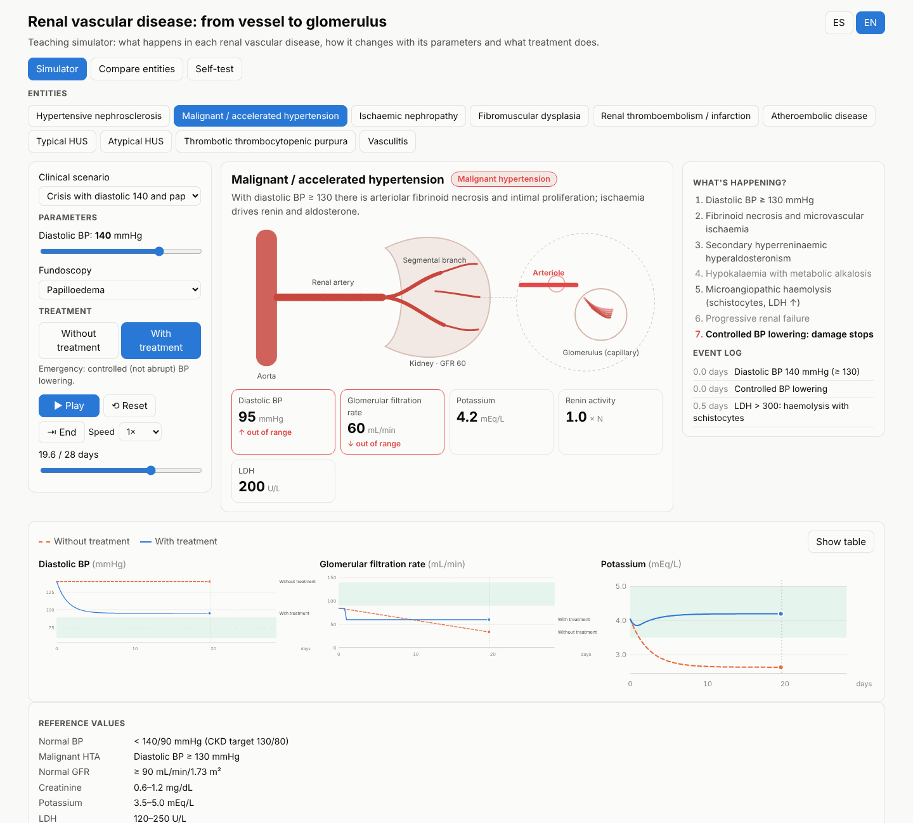

# Renal vascular disease: from vessel to glomerulus

**Nefropatías vasculares: del vaso al glomérulo** — interactive teaching simulator (Spanish / English).

**Live demo:** https://ferasmed-dev.github.io/renal-vascular-disease/ · English: https://ferasmed-dev.github.io/renal-vascular-disease/?lang=en



One shared model of the renal arterial tree — aorta, renal artery, segmental branch, arteriole and glomerular capillary — with ten entities placed where they do their damage. Students pick an entity, move its parameters and compare the course with and without treatment.

## What it shows

| Entity | Site | Time axis | Treatment arm |
|---|---|---|---|
| Hypertensive nephrosclerosis | arteriole | years | triple therapy to a BP target |
| Malignant / accelerated hypertension | arteriole | days | controlled BP lowering |
| Ischaemic nephropathy (atherosclerotic stenosis) | renal artery | months | ACEi/ARB or revascularisation |
| Fibromuscular dysplasia | renal artery | months | angioplasty or ACEi/ARB |
| Renal thromboembolism / infarction | segmental / main artery | hours | thrombolysis at a chosen hour |
| Atheroembolic disease | arteriole | weeks | none (no specific treatment) |
| Typical (Shiga-toxin) HUS | glomerular capillary | days | supportive care |
| Atypical HUS | glomerular capillary | days | eculizumab from a chosen day |
| Thrombotic thrombocytopenic purpura | capillary | days | plasma exchange |
| Vasculitis (small vessel / PAN) | glomerulus / arteries | weeks | induction from a chosen week |

Every entity offers:

- a **schematic** that highlights where the lesion sits and grows with severity;
- **sliders and choices** for the parameters that drive it;
- a **sin / con tratamiento** (without / with treatment) comparison drawn on the same chart (dashed = without, solid = with);
- a **"¿Qué está pasando?"** panel that lights up each step of the mechanism as it happens, plus an **event log**;
- gauges with reference ranges, a **data-table view** of every chart, a **compare** tab with all entities side by side and a **self-test** tab.

## Curriculum fit

For students and teachers at any Spanish medical faculty.

- **Module (Orden ECI/332/2008):** Módulo III, *Formación clínica humana* (with support from Módulo II for physiology and pathology).
- **Typical subjects:** Fisiopatología, Patología médica / Nefrología, Anatomía patológica, Farmacología.
- **MIR:** core content of the Nefrología block.

## For teachers

Every scenario has a deep link you can project or share. Add `&lang=en` for English.

| Preset | Scenario (EN) | Expected result | Link |
|---|---|---|---|
| `hta_mal_controlada` | Years of poorly controlled HTA | GFR 95 → 4 mL/min in 20 years untreated; ~75 with therapy | [ES](https://ferasmed-dev.github.io/renal-vascular-disease/?preset=hta_mal_controlada) · [EN](https://ferasmed-dev.github.io/renal-vascular-disease/?preset=hta_mal_controlada&lang=en) |
| `sobretratamiento` | Over-treated older patient (BP < 120) | treated arm still reaches CKD G4 (GFR ~20) | [ES](https://ferasmed-dev.github.io/renal-vascular-disease/?preset=sobretratamiento) · [EN](https://ferasmed-dev.github.io/renal-vascular-disease/?preset=sobretratamiento&lang=en) |
| `hta_maligna_papila` | Crisis with diastolic 140 and papilloedema | K⁺ ~2.6, renin ↑, GFR 85 → 11 in 4 weeks; treated GFR stabilises at 60 | [ES](https://ferasmed-dev.github.io/renal-vascular-disease/?preset=hta_maligna_papila) · [EN](https://ferasmed-dev.github.io/renal-vascular-disease/?preset=hta_maligna_papila&lang=en) |
| `hta_acelerada` | Diastolic 134 with grade III retinopathy | badge "accelerated"; GFR 85 → 26 untreated | [ES](https://ferasmed-dev.github.io/renal-vascular-disease/?preset=hta_acelerada) · [EN](https://ferasmed-dev.github.io/renal-vascular-disease/?preset=hta_acelerada&lang=en) |
| `estenosis_bilateral_ieca` | Bilateral stenosis: ACEi started | GFR drops ~27 % right after ACEi (70 → 51) | [ES](https://ferasmed-dev.github.io/renal-vascular-disease/?preset=estenosis_bilateral_ieca) · [EN](https://ferasmed-dev.github.io/renal-vascular-disease/?preset=estenosis_bilateral_ieca&lang=en) |
| `estenosis_revasc` | Bilateral stenosis: revascularisation | SBP 170 → 135, GFR stable ~68 | [ES](https://ferasmed-dev.github.io/renal-vascular-disease/?preset=estenosis_revasc) · [EN](https://ferasmed-dev.github.io/renal-vascular-disease/?preset=estenosis_revasc&lang=en) |
| `fmd_joven` | Young woman with HTA and hypokalaemia | SBP ~158, K⁺ 3.5 untreated; angioplasty → SBP 124, K⁺ 4.2 | [ES](https://ferasmed-dev.github.io/renal-vascular-disease/?preset=fmd_joven) · [EN](https://ferasmed-dev.github.io/renal-vascular-disease/?preset=fmd_joven&lang=en) |
| `fmd_bilateral_ieca` | Bilateral dysplasia treated with ACEi | hypotension (SBP 102) and GFR drop | [ES](https://ferasmed-dev.github.io/renal-vascular-disease/?preset=fmd_bilateral_ieca) · [EN](https://ferasmed-dev.github.io/renal-vascular-disease/?preset=fmd_bilateral_ieca&lang=en) |
| `infarto_precoz` | AF with renal infarct: thrombolysis at 3 h | GFR recovers to ~97; LDH stays ~230 | [ES](https://ferasmed-dev.github.io/renal-vascular-disease/?preset=infarto_precoz) · [EN](https://ferasmed-dev.github.io/renal-vascular-disease/?preset=infarto_precoz&lang=en) |
| `infarto_tardio` | Renal infarct: thrombolysis at 12 h | no salvage: GFR ~50, LDH ~1,120 | [ES](https://ferasmed-dev.github.io/renal-vascular-disease/?preset=infarto_tardio) · [EN](https://ferasmed-dev.github.io/renal-vascular-disease/?preset=infarto_tardio&lang=en) |
| `infarto_monorreno` | Infarct in a functional single kidney | anuria untreated; ~94 after thrombolysis at 3 h | [ES](https://ferasmed-dev.github.io/renal-vascular-disease/?preset=infarto_monorreno) · [EN](https://ferasmed-dev.github.io/renal-vascular-disease/?preset=infarto_monorreno&lang=en) |
| `ateroembolia_cateterismo` | Two weeks after a catheterisation | eosinophils peak ~880/µL at week 2; GFR 60 → 33 | [ES](https://ferasmed-dev.github.io/renal-vascular-disease/?preset=ateroembolia_cateterismo) · [EN](https://ferasmed-dev.github.io/renal-vascular-disease/?preset=ateroembolia_cateterismo&lang=en) |
| `shu_diarrea` | Child with bloody diarrhoea | platelets nadir ~130, GFR nadir ~36 around day 9, full recovery | [ES](https://ferasmed-dev.github.io/renal-vascular-disease/?preset=shu_diarrea) · [EN](https://ferasmed-dev.github.io/renal-vascular-disease/?preset=shu_diarrea&lang=en) |
| `shu_atipico_precoz` | Atypical HUS: early eculizumab | platelets normal within 48 h; GFR kept ~78 (vs 23) | [ES](https://ferasmed-dev.github.io/renal-vascular-disease/?preset=shu_atipico_precoz) · [EN](https://ferasmed-dev.github.io/renal-vascular-disease/?preset=shu_atipico_precoz&lang=en) |
| `shu_atipico_tardio` | Atypical HUS: late eculizumab | platelets recover but GFR stays ~33 | [ES](https://ferasmed-dev.github.io/renal-vascular-disease/?preset=shu_atipico_tardio) · [EN](https://ferasmed-dev.github.io/renal-vascular-disease/?preset=shu_atipico_tardio&lang=en) |
| `ptt_grave` | TTP with ADAMTS13 at 3 % | platelets ~35 and neuro index ~2 untreated; normal with plasma exchange | [ES](https://ferasmed-dev.github.io/renal-vascular-disease/?preset=ptt_grave) · [EN](https://ferasmed-dev.github.io/renal-vascular-disease/?preset=ptt_grave&lang=en) |
| `vasculitis_anca` | ANCA vasculitis with RPGN | GFR 90 → 5 in 8 weeks untreated; ~77 with induction at week 2 | [ES](https://ferasmed-dev.github.io/renal-vascular-disease/?preset=vasculitis_anca) · [EN](https://ferasmed-dev.github.io/renal-vascular-disease/?preset=vasculitis_anca&lang=en) |
| `pan` | Polyarteritis nodosa | stepwise infarcts, SBP up to ~175; induction at week 6 keeps GFR ~57 | [ES](https://ferasmed-dev.github.io/renal-vascular-disease/?preset=pan) · [EN](https://ferasmed-dev.github.io/renal-vascular-disease/?preset=pan&lang=en) |

You can also open a single entity with `?entity=<key>` (keys are listed in `src/model.js`).

## Model

Each entity is a small explicit time-step model (`runner()` in `src/model.js`, step `dt`). Main relations:

- **Nephrosclerosis:** `dGFR/dt = −(1 + 0.08·max(0, SBP − 130))` mL/min/year; treatment brings SBP to the target in ~6 months; a target < 120 mmHg adds 1.5 mL/min/year of ischaemic loss.
- **Malignant HTA:** drive `= clamp((DBP − 110)/25)` (×0.25 if DBP < 130) pushes renin (up to ~5× normal), K⁺ (down to ~2.6), LDH and platelets towards new targets with τ = 2.5 days; GFR falls 2.2·drive mL/min/day. Treatment lowers DBP towards 95 mmHg (τ 1.5 days).
- **Ischaemic nephropathy / FMD:** haemodynamic significance ramps between 60 % and 95 % stenosis (FMD 50–90 %). Bilateral disease loses GFR ~3× faster than unilateral (no compensating kidney). ACEi with bilateral stenosis drops GFR by 30 % × significance at once; revascularisation helps only at ≥ 70 %.
- **Infarction:** necrosis of the occluded territory follows a sigmoid centred on the window (6 h main artery, 24 h segmental); thrombolysis freezes it. Main artery = 50 % of renal mass (100 % in a single kidney).
- **Atheroembolism:** `GFR = GFR₀ − 0.065·GFR₀·load·(1 − e^(−t/2.5))` with a transient eosinophilia peak at week 2 and mild C3 consumption.
- **HUS / TTP:** Gaussian dips of platelets, haemoglobin and GFR (typical HUS, self-limited); persistent TMA with progressive GFR loss (atypical HUS) reversed by eculizumab with a recovery ceiling that falls 4.5 % per day of delay; TTP severity from ADAMTS13 < 12 % drives platelets and a 0–3 neurological index.
- **Vasculitis:** small vessel loses 14·activity mL/min/week (RPGN); PAN causes stepwise 14 % infarcts. Induction stops progression; recovery ceiling falls 7 % per week of delay.

GFR is converted to creatinine with a steady-state approximation, `Cr ≈ 90 / GFR` (0.9 mg/dL at 100 mL/min). **Model** tag: constants marked "Model" in `src/model.js` are teaching assumptions tuned so each preset reproduces the textbook course; they are not fitted to patient data.

### Parameters

| Parameter | Range (default) | Basis |
|---|---|---|
| SBP (nephrosclerosis) | 140–200 mmHg (165) | ESC/ESH: HTA ≥ 140/90 |
| BP target on treatment | 110–140 mmHg (130) | KDIGO/ESC: 130/80; avoid < 120 |
| DBP (malignant HTA) | 110–150 mmHg (135) | malignant HTA defined at DBP ≥ 130 |
| Stenosis | 40–95 % (80) | significant > 70 %; revascularise if > 60–75 % + clinical criterion |
| Thrombolysis time | 1–30 h (4) | window < 6 h main artery, < 24 h segmental |
| Embolic load | 1–10 (6) | Model |
| ADAMTS13 | 0–30 % (5) | TTP < 10 % |
| Eculizumab / induction start | day 1–20 / week 1–10 | Model (earlier is better) |

### Known simplifications

- One kidney-level GFR number; no separate single-kidney GFR or proteinuria output.
- Creatinine is a steady-state conversion; in fast AKI it would lag behind GFR in reality.
- Treatment effects are switched on at a single time point; doses are not modelled.
- Malignant vs accelerated HTA differ only in the fundoscopy label (the renal course is the same model).

### Content beyond the core notes

- **Eculizumab** is labelled **anti-C5** (the core notes say "anti-C5b" in one place).
- **TTP treatment (plasma exchange)** is not detailed in the core notes; it is standard care (ISTH 2020).
- **Controlled BP lowering in malignant HTA** (not abrupt) follows ESC/ESH guidance; the notes only say "urgent".

## Layout

```
index.html
src/model.js       pure model: entities, gauges, presets, simulate()
src/i18n.js        ES + EN strings (events are factories, so a language switch re-renders them)
src/ui.js          DOM, animation loop, explanations; exposes window.__sim for automated checks
src/schematic.js   SVG schematic of the anatomy, highlighted per entity
src/charts.js      dependency-free SVG line charts with hover tooltips and table view
src/styles.css     light/dark via prefers-color-scheme, responsive
tests/model.test.js
curriculum.json    topic metadata
```

## Run locally

```bash
python3 -m http.server 8000
# open http://localhost:8000/
```

No build step, no dependencies.

## Tests

```bash
npm test        # node --test (Node 18+)
```

The tests cover well-formed output for every entity at default and extreme parameters (finite, non-negative, valid steps), purity, i18n completeness in both languages, every preset, and the key mechanism of each entity (direction of each effect and the treatment comparison). GitHub Actions runs them on every push.

## Deploy (GitHub Pages)

Settings → Pages → *Deploy from a branch* → `main` / `(root)`. The site is served at https://ferasmed-dev.github.io/renal-vascular-disease/.

## References

- KDIGO 2021 Clinical Practice Guideline for the Management of Blood Pressure in CKD.
- 2023 ESH Guidelines for the management of arterial hypertension.
- ISTH guideline for the treatment of thrombotic thrombocytopenic purpura (2020).
- KDIGO 2024 guideline for ANCA-associated vasculitis.
- Harrison's Principles of Internal Medicine, 21st ed., chapters on vascular injury to the kidney.
- Farreras-Rozman, *Medicina Interna*, 19ª ed., Nefrología.

---

Herramienta docente · no apta para uso clínico — Teaching tool · not for clinical use. MIT licence © 2026 Feras Elhissi.
